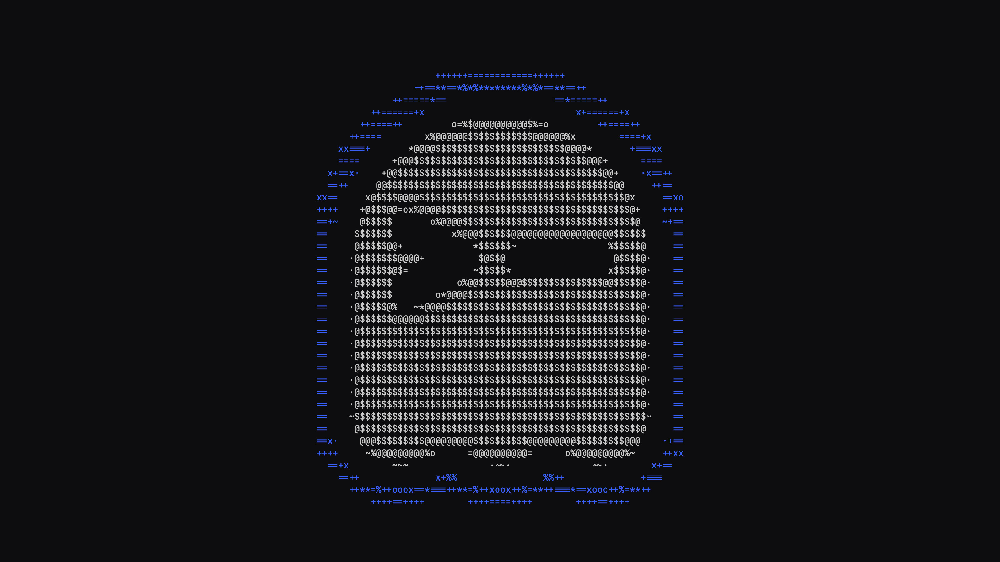
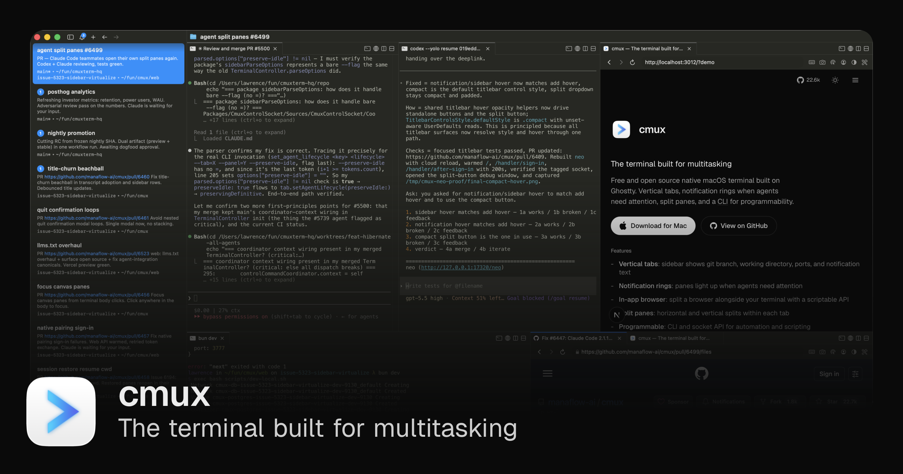
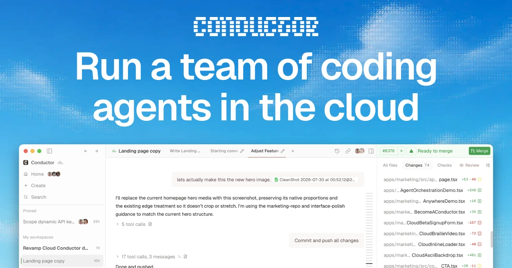
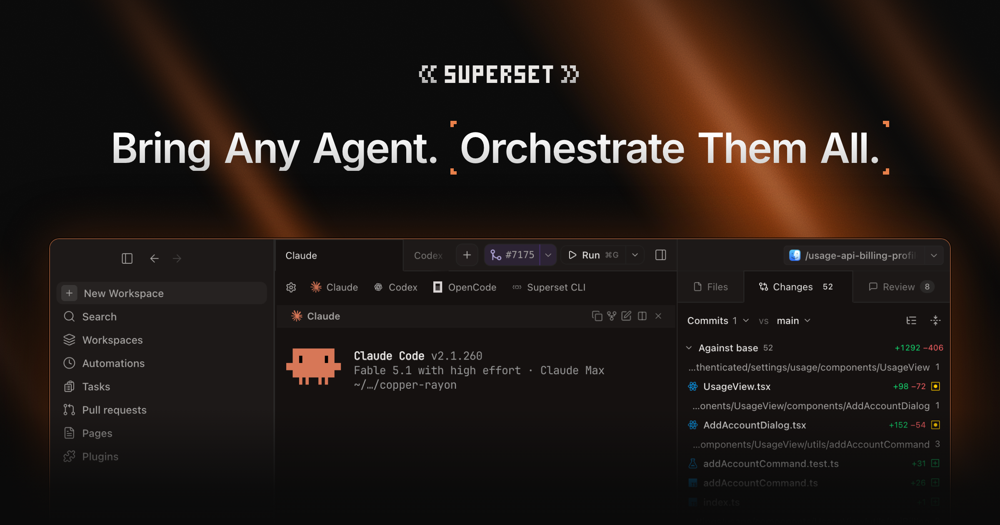

  <a class="terminal-deck-card" href="https://ghostty.org/" target="_blank" rel="noopener noreferrer">
    
    <strong>Ghostty</strong>
  </a>
  <a class="terminal-deck-card" href="https://www.warp.dev/" target="_blank" rel="noopener noreferrer">
    
    <strong>Warp</strong>
  </a>
  <a class="terminal-deck-card terminal-deck-card--light" href="https://cmux.com/es" target="_blank" rel="noopener noreferrer">
    
    <strong>cmux</strong>
  </a>
  <a class="terminal-deck-card" href="https://www.conductor.build/" target="_blank" rel="noopener noreferrer">
    
    <strong>Conductor</strong>
  </a>
  <a class="terminal-deck-card" href="https://superset.sh/" target="_blank" rel="noopener noreferrer">
    
    <strong>Superset</strong>
  </a>

Una vez que empiezas a correr múltiples agentes de AI en varios proyectos al mismo tiempo, la terminal deja de ser solo una terminal.

En ese punto ya no alcanza con que sea rápida. También necesitas visibilidad, aislamiento, notificaciones, workspaces y una forma de evitar que varios agentes se pisen entre sí.

Este fue mi recorrido: [Ghostty](https://ghostty.org/), [Warp](https://www.warp.dev/), [cmux](https://cmux.com/es), [Conductor](https://www.conductor.build/), y por último [Superset](https://superset.sh/).

## Ghostty

Empecé con Ghostty porque se sentía rápida, nativa y limpia.

Durante bastante tiempo eso me alcanzó de sobra. De hecho, me sigue pareciendo de las mejores terminales si lo que buscas es una experiencia rápida y bien construida. Pero cuando empecé a meterme más fuerte en flujos con AI, sentí que me estaba perdiendo algunas de las ideas nuevas que otras terminales modernas estaban empujando alrededor de agentes.

Entonces no fue que Ghostty me pareciera mala. Fue más bien que yo ya estaba buscando la siguiente capa arriba de una gran terminal.

## Warp

Después me pasé a Warp porque parecía el siguiente paso lógico.

Tenía una interfaz más moderna, buen manejo de pestañas y divisiones, y una dirección mucho más orientada a AI. Sobre el papel sonaba exactamente a lo que yo estaba buscando.

Pero con el tiempo me di cuenta de que la estaba usando casi como una terminal normal. Sí, tenía cosas mejores, pero nunca terminé de sentir que fuera el lugar desde donde realmente quería coordinar múltiples proyectos y múltiples agentes en paralelo.

## cmux

Luego probé cmux, y esta me llamó la atención enseguida.

Se sentía como eso que le faltaba a Ghostty: pestañas verticales, paneles divididos, mejor organización por workspace, notificaciones, e incluso la idea de tener un navegador al lado de la terminal. Como concepto, para trabajar con agentes, tenía muchísimo sentido.

Igualmente nunca terminé de enamorarme. Se veía prometedora, pero todavía la sentía poco pulida. En mi caso las notificaciones no me funcionaban tan bien como esperaba, y al volver a cmux desde otra app el foco no se sentía tan fino como yo quería.

La dirección me gustó mucho. La ejecución todavía no tanto como para quedarme ahí.

## Conductor

Después de eso me fui a Conductor.

Esta fue la primera donde sentí una UI realmente refinada. Todo se veía más intencional y la idea de workspace multi-agente estaba mucho más madura. Era más fácil ver qué estaba pasando y mantener ordenado el trabajo.

Pero hubo dos cosas que me hicieron seguir buscando. La primera es que no es open source. La segunda, y para mí la más importante, es que no encajaba con la mezcla de CLIs que yo realmente quería usar, sobre todo ahora que OpenCode es una parte clave de mi flujo.

Así que, aunque me parece un producto muy bien construido, no fue el lugar donde me quise quedar.

## Superset

Superset fue la primera herramienta donde realmente me hizo click todo el flujo.

Me da gestión de workspaces, worktrees, un sistema de notificaciones que sí ayuda, y soporte para las CLIs que a mí me importan: OpenCode, Claude Code y Codex CLI.

Y eso importa más de lo que parece. Cuando ya te acostumbras a cierto flujo con agentes, que una herramienta te obligue a cambiarlo mete fricción. Superset no me obliga a eso. Me da estructura sin forzarme a usar un agente específico.

Ahí está la diferencia.

## Comparativa rápida

| Herramienta | Qué me aportó | Por qué seguí buscando |
| --- | --- | --- |
| Ghostty | Una terminal rápida, nativa y limpia | Empecé a extrañar features más orientadas a workflows con AI |
| Warp | Mejor UX, pestañas, divisiones y una dirección más moderna | La seguía usando como una terminal bastante normal |
| cmux | Mejor organización por workspace e ideas más cercanas al flujo con agentes | La seguía sintiendo verde en detalles importantes |
| Conductor | Una UI multi-agente mucho más refinada | No encajaba con la mezcla de CLIs que yo quería |
| Superset | Workspaces, worktrees, notificaciones y libertad de CLI | Es mi elección actual |

## Mi stack actual

Yo hoy ocupo Superset + OpenCode + Claude Code CLI + Codex CLI porque me permite trabajar con la CLI que yo quiera sin perder de vista lo que está pasando en múltiples proyectos y múltiples ventanas al mismo tiempo.

Más o menos así lo uso:

- Normalmente trabajo en 3 o 4 proyectos en paralelo.
- Cada proyecto tiene 2 o 3 terminales.
- Cada agente vive en un worktree distinto para que no se pisen los talones.
- Mi setup principal hoy es OpenCode con GPT 5.4 high y Opus 4.6 high.
- Si quiero probar algo nuevo o comparar comportamientos, salto rápido a Claude Code.
- Codex CLI la uso mucho menos, pero igual forma parte del stack.
- VS Code lo abro más que nada para revisión manual fina.

La UI la sigo haciendo manual. Esa parte para mí sigue siendo artesanal. Prefiero hacer yo la maquetación y las decisiones visuales, y después dejar que la AI me ayude a pulir la lógica sin tocar la interfaz.
