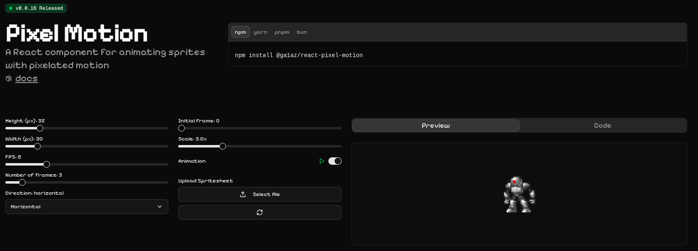

A lightweight React component for creating smooth, pixelated sprite animations. Perfect for games, retro-style interfaces, and pixel art animations. The npm package is available at [@ga1az/react-pixel-motion](https://npmjs.com/package/@ga1az/react-pixel-motion).

[Open the interactive playground](https://react-pixel-motion.ga1az.com/)



## Features

- 🎮 Easy-to-use React component
- 🖼️ Support for sprite sheets and individual frames
- ⚡ Lightweight with minimal dependencies
- 📱 Responsive and customizable
- 🧩 TypeScript support

## Installation

```bash
npm install @ga1az/react-pixel-motion
# or
yarn add @ga1az/react-pixel-motion
# or
pnpm add @ga1az/react-pixel-motion
# or
bun add @ga1az/react-pixel-motion
```

## Quick Example

```jsx
import { PixelMotion } from '@ga1az/react-pixel-motion';

function App() {
  return (
    <PixelMotion
      src="/path/to/sprite-sheet.png"
      width={24} // Width of each frame in pixels
      height={31} // Height of each frame in pixels
      frameCount={3} // Total number of frames in the sprite sheet
      fps={10} // Frames per second for the animation
      scale={5} // Scale factor for the sprite
      startFrame={0} // Initial frame to start the animation
      loop={true} // Whether the animation should loop
      shouldAnimate={true} // Whether the animation should play
      direction="horizontal" // Direction of the sprite sheet
    />
  );
}
```

